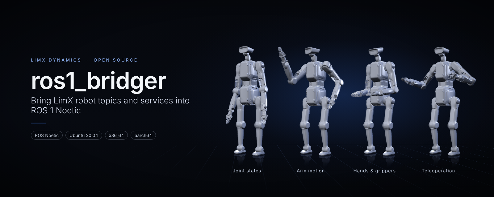
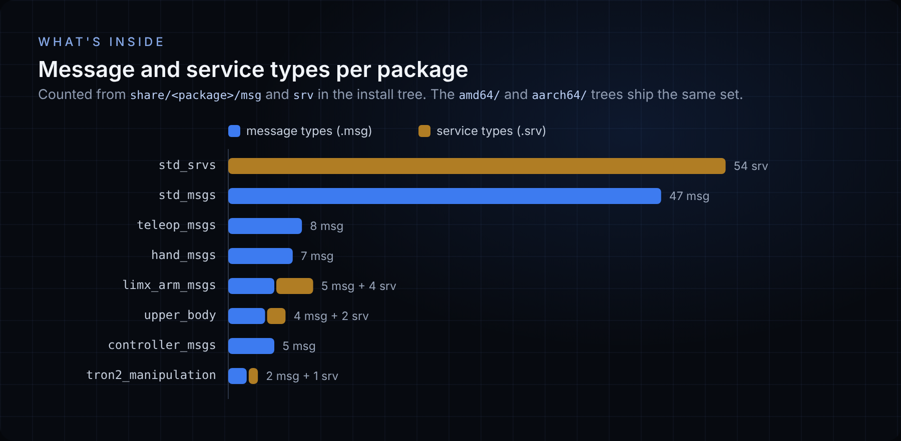
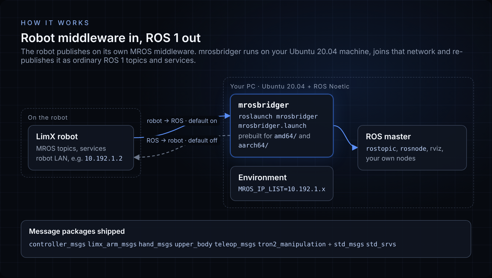

<p align="center">
  
</p>

<p align="center">
  <b>English</b> | <a href="README_cn.md">中文</a>
</p>

<p align="center">
  <a href="LICENSE"></a>
  
  
  
  <a href="https://github.com/limxdynamics/limxdynamics/blob/main/doc/wechat_qr.png"></a>
</p>
<p align="center"><sub>For partnership and procurement inquiries, contact <a href="mailto:opensource@limxdynamics.com">opensource@limxdynamics.com</a></sub></p>

# ros1_bridger

**Use a LimX robot's topics and services from ROS 1 Noetic on your own computer.** The robot talks over its own MROS middleware; `ros1_bridger` runs the `mrosbridger` node on your Ubuntu 20.04 machine and re-publishes that traffic as ordinary ROS 1 topics and services, so `rostopic`, rviz and your existing nodes just see them.

> Requires Ubuntu 20.04 with ROS Noetic, on the same network as the robot.

## Highlights

- **Nothing to compile.** Ready-to-source install trees ship for both `amd64/` (x86_64) and `aarch64/`, so it runs on a desktop and on ARM boards alike.
- **Robot data in plain ROS 1.** Once launched, the robot's topics and services show up in `rostopic list` and can be used from rviz, rosbag or your own nodes.
- **The message types come with it.** Eight message packages ship in the install tree, covering joint control, arms, hands, upper body, teleoperation and TRON2 manipulation.
- **Safe by default.** Robot-to-ROS bridging is on; ROS-to-robot is off until you enable it with one launch argument.
- **Filter what you bridge.** Include and exclude lists pick exactly which topics, services and actions cross the bridge.

## What it bridges

<p align="center">
  
</p>

| Package | Contents |
| --- | --- |
| `controller_msgs` | Joint commands, joint state, IMU data (`JointCmd`, `JointState`, `IMUData`, ...) |
| `limx_arm_msgs` | Arm joint data and status, servo commands; `gripper`, `motion`, `desire_pos` services |
| `hand_msgs` | Hand commands and state, tactile commands and state |
| `upper_body` | Arm servo and status, waist command; `arm_move`, `moveJ` services |
| `teleop_msgs` | Teleoperation intent, targets, limb and session state, VR state |
| `tron2_manipulation` | Arm pose and status; `arm_move` service |
| `std_msgs`, `std_srvs` | Standard message types, and get / set service types for common value types |

The `amd64/` and `aarch64/` trees ship the same set.

## How it works

<p align="center">
  
</p>

## Quick start

On an Ubuntu 20.04 machine with ROS Noetic, connected to the robot network:

```bash
git clone https://github.com/limxdynamics/ros1-bridger.git
cd ros1-bridger
export MROS_IP_LIST=10.192.1.x
source /opt/ros/noetic/setup.bash
source amd64/noetic/install/setup.bash      # use aarch64/ on ARM
roslaunch mrosbridger mrosbridger.launch
```

Then, in a second terminal, `rostopic list` shows the bridged topics. The full steps, including network checks, follow below.

## Complete usage steps

### 1. Environment preparation

- Operating System Requirement: Ensure the local device runs Ubuntu 20.04 LTS (x86_64 or aarch64 architecture).
- ROS Version: ROS Noetic must be installed. For installation, refer to the [official ROS Noetic installation guide](http://wiki.ros.org/noetic/Installation/Ubuntu).

### 2. Network connection and verification

- Connect to the Robot Network: Access the robot's local area network via wired or wireless connection (ensure it is on the same network segment as the target device).

- Network Connectivity Test

  ```bash
  # Test connectivity to the target device (10.192.1.2)
  ping 10.192.1.2
  ```

- Adjust network buffer (improve communication performance):

  ```bash
  echo -e "net.core.wmem_max=12582912\nnet.core.rmem_max=12582912" | sudo tee -a /etc/sysctl.conf
  sudo sysctl -p
  ```

### 3. Configure ros1_bridger connection parameters

- Set the ros1_bridger communication address:

  ```bash
  export MROS_IP_LIST=10.192.1.x
  ```

### 4. Launch ros1_bridger

Select the corresponding commands based on the local device architecture:

**x86_64 architecture**

```bash
# Load ROS environment
source /opt/ros/noetic/setup.bash

# Load ros1_bridger installation environment
source amd64/noetic/install/setup.bash

# Launch the bridge node
roslaunch mrosbridger mrosbridger.launch
```

**aarch64 architecture**

```bash
# Load ROS environment
source /opt/ros/noetic/setup.bash

# Load ros1_bridger installation environment
source aarch64/noetic/install/setup.bash

# Launch the bridge node
roslaunch mrosbridger mrosbridger.launch
```

### 5. Verify if the bridge works

- Check if the node starts normally:

  ```bash
  # Open a new terminal and view active nodes
  rosnode list
  ```

- Test topic communication:

  ```bash
  # View the list of bridged topics
  rostopic list
  ```

## Launch arguments

All arguments of `mrosbridger.launch`, with their defaults from `share/mrosbridger/launch/mrosbridger.launch`:

| Argument | Default | Meaning |
| --- | --- | --- |
| `bridge_mros2ros` | `1` | Bridge robot (MROS) traffic into ROS 1 |
| `bridge_ros2mros` | `0` | Bridge ROS 1 traffic to the robot |
| `bridge_ros_queue_size` | `100` | ROS publisher / subscriber queue size |
| `service_timeout` | `20.0` | Service call timeout in seconds |
| `reliable` | `0` | Reliability flag passed to the bridge |
| `latch` | `0` | Latch flag passed to the bridge |
| `mros2ros_include` / `mros2ros_execlude` | empty | Topics, services and actions to include / exclude, separated by `;` |
| `ros2mros_include` / `ros2mros_execlude` | empty | Same, for the ROS-to-robot direction |

For example, to also send commands from ROS to the robot:

```bash
roslaunch mrosbridger mrosbridger.launch bridge_ros2mros:=1
```

The install tree also contains self-test nodes under `lib/mrosbridger/` (`mrosbridger_test_topic_*`, `mrosbridger_test_service_*`, `mrosbridger_test_action_*`).

## License

See [LICENSE](LICENSE). Third-party components are described in [NOTICE](NOTICE).
