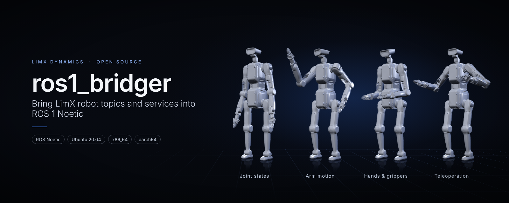
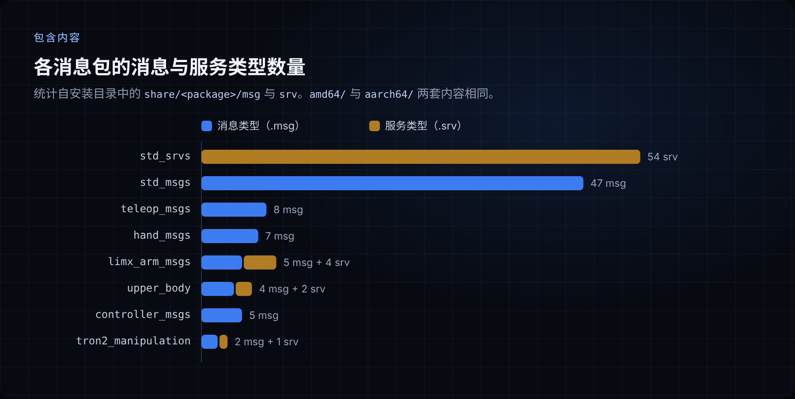
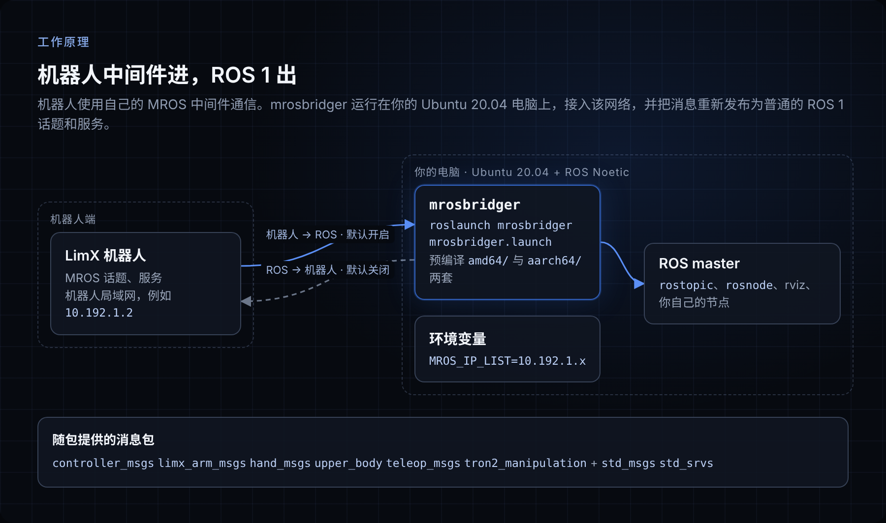

<p align="center">
  
</p>

<p align="center">
  <a href="README.md">English</a> | <b>中文</b>
</p>

<p align="center">
  <a href="LICENSE"></a>
  
  
  
  <a href="https://github.com/limxdynamics/limxdynamics/blob/main/doc/wechat_qr.png"></a>
</p>
<p align="center"><sub>合作采购请联系 <a href="mailto:opensource@limxdynamics.com">opensource@limxdynamics.com</a></sub></p>

# ros1_bridger

**在你自己的电脑上，用 ROS 1 Noetic 使用 LimX 机器人的话题和服务。** 机器人内部使用自己的 MROS 中间件通信；`ros1_bridger` 在你的 Ubuntu 20.04 电脑上运行 `mrosbridger` 节点，把这些通信重新发布为普通的 ROS 1 话题和服务，`rostopic`、rviz 和你已有的节点可以直接使用。

> 需要 Ubuntu 20.04 + ROS Noetic，并与机器人处于同一网络。

## 亮点

- **无需编译。** 同时提供 `amd64/`（x86_64）和 `aarch64/` 两套可直接 source 的安装目录，台式机和 ARM 板卡都能用。
- **机器人数据变成普通 ROS 1。** 启动后，机器人的话题和服务会出现在 `rostopic list` 中，可直接用于 rviz、rosbag 或你自己的节点。
- **消息类型随包提供。** 安装目录内含 8 个消息包，覆盖关节控制、手臂、手部、上半身、遥操作和 TRON2 操作。
- **默认安全。** 默认只开启机器人到 ROS 的方向；ROS 到机器人的方向需要用一个启动参数显式打开。
- **按需过滤。** 用 include / exclude 列表精确选择哪些话题、服务和 action 经过桥接。

## 桥接内容

<p align="center">
  
</p>

| 消息包 | 内容 |
| --- | --- |
| `controller_msgs` | 关节指令、关节状态、IMU 数据（`JointCmd`、`JointState`、`IMUData` 等） |
| `limx_arm_msgs` | 手臂关节数据与状态、舵机指令；`gripper`、`motion`、`desire_pos` 服务 |
| `hand_msgs` | 手部指令与状态、触觉指令与状态 |
| `upper_body` | 手臂舵机与状态、腰部指令；`arm_move`、`moveJ` 服务 |
| `teleop_msgs` | 遥操作意图、目标、肢体与会话状态、VR 状态 |
| `tron2_manipulation` | 手臂位姿与状态；`arm_move` 服务 |
| `std_msgs`、`std_srvs` | 标准消息类型，以及常用数值类型的 get / set 服务类型 |

`amd64/` 与 `aarch64/` 两套内容相同。

## 工作原理

<p align="center">
  
</p>

## 快速开始

在已安装 ROS Noetic、并接入机器人网络的 Ubuntu 20.04 电脑上：

```bash
git clone https://github.com/limxdynamics/ros1-bridger.git
cd ros1-bridger
export MROS_IP_LIST=10.192.1.x
source /opt/ros/noetic/setup.bash
source amd64/noetic/install/setup.bash      # ARM 设备使用 aarch64/
roslaunch mrosbridger mrosbridger.launch
```

然后在另一个终端执行 `rostopic list` 即可看到桥接的话题。包含网络检查的完整步骤见下文。

## 完整使用步骤

### 1. 环境准备

- 操作系统要求：确保本地设备运行 **Ubuntu 20.04 LTS**（x86_64 或 aarch64 架构）
- ROS 版本：已安装 **ROS Noetic**（若未安装，参考 [ROS Noetic 官方安装指南](http://wiki.ros.org/noetic/Installation/Ubuntu)）

### 2. 网络连接与验证

- 连接机器人网络：通过有线或无线方式接入机器人所在局域网（确保与目标设备在同一网段）

- 网络连通性测试：

  ```bash
  # 测试与目标设备（10.192.1.2）的连通性
  ping 10.192.1.2
  ```

- 调整网络缓冲区（提升通信性能）：

  ```bash
  echo -e "net.core.wmem_max=12582912\nnet.core.rmem_max=12582912" | sudo tee -a /etc/sysctl.conf
  sudo sysctl -p
  ```

### 3. 配置 ros1_bridger 连接参数

- 设置ros1 bridger通信地址：

  ```bash
  export MROS_IP_LIST=10.192.1.x
  ```

### 4. 启动 ros1_bridger

根据本地设备架构选择对应命令：

**x86_64 架构**

```bash
# 加载 ROS 环境
source /opt/ros/noetic/setup.bash

# 加载 ros1_bridger 安装环境
source amd64/noetic/install/setup.bash

# 启动桥接节点
roslaunch mrosbridger mrosbridger.launch
```

**aarch64 架构**

```bash
# 加载 ROS 环境
source /opt/ros/noetic/setup.bash

# 加载 ros1_bridger 安装环境
source aarch64/noetic/install/setup.bash

# 启动桥接节点
roslaunch mrosbridger mrosbridger.launch
```

### 5. 验证桥接是否生效

- 查看节点是否正常启动：

  ```bash
  # 新开终端，查看活跃节点
  rosnode list
  ```

- 测试话题通信：

  ```bash
  # 查看桥接的话题列表
  rostopic list
  ```

## 启动参数

`mrosbridger.launch` 的全部参数，默认值取自 `share/mrosbridger/launch/mrosbridger.launch`：

| 参数 | 默认值 | 说明 |
| --- | --- | --- |
| `bridge_mros2ros` | `1` | 把机器人（MROS）通信桥接到 ROS 1 |
| `bridge_ros2mros` | `0` | 把 ROS 1 通信桥接到机器人 |
| `bridge_ros_queue_size` | `100` | ROS 发布 / 订阅队列长度 |
| `service_timeout` | `20.0` | 服务调用超时（秒） |
| `reliable` | `0` | 传给桥接节点的可靠性开关 |
| `latch` | `0` | 传给桥接节点的 latch 开关 |
| `mros2ros_include` / `mros2ros_execlude` | 空 | 要包含 / 排除的话题、服务和 action，用 `;` 分隔 |
| `ros2mros_include` / `ros2mros_execlude` | 空 | 同上，作用于 ROS 到机器人方向 |

例如，同时允许 ROS 向机器人发送指令：

```bash
roslaunch mrosbridger mrosbridger.launch bridge_ros2mros:=1
```

安装目录的 `lib/mrosbridger/` 下还附带自测节点（`mrosbridger_test_topic_*`、`mrosbridger_test_service_*`、`mrosbridger_test_action_*`）。

## 许可证

见 [LICENSE](LICENSE)。第三方组件说明见 [NOTICE](NOTICE)。
